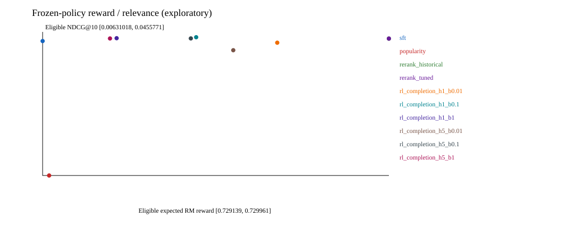
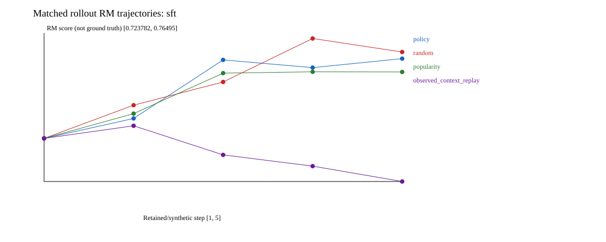

# RL-дообучение последовательной рекомендательной модели: исследование на Yambda

**Главный результат:** в проведённом эксперименте RL немного увеличил оценку обученной модели вознаграждения, но не дал практически значимого преимущества над исходной моделью и простым переранжированием. Для выбранной политики прирост ожидаемого proxy составил **0,0763%**, а изменение NDCG@10 на доступных целевых объектах — **−1,06%**. Сохранение релевантности в пределах заданного допуска статистически не установлено.

Это **отрицательный исследовательский результат**, а не доказательство бесполезности RL в рекомендациях вообще. Ни удовлетворённость, ни удержание, ни причинное влияние рекомендаций на пользователей здесь не измерялись.

Этот README — **основной исследовательский отчёт и точка входа в решение**. Основные policy-таблицы относятся к историческому обучению ниже; новые inference-диагностики (§5.5) выполнены на тех же замороженных весах кодом `e3cf359`:

- артефакт: [`pilot-seed42-submission-2.zip`, релиз v0.2.0-pilot-2](https://github.com/WARParrot/rl-recsys/releases/tag/v0.2.0-pilot-2);
- версия экспериментального кода: [`68578e4`](https://github.com/WARParrot/rl-recsys/tree/68578e4ae753214b506d146e04f8207686b3c852);
- seed обучения: `42`;
- статус: `exploratory_reuse` — тестовый период уже просматривался до уточнения протокола. Результаты описательные, а не новая независимая подтверждающая проверка.

Код, конфигурация и инструкции находятся в этом репозитории; метрики и журналы — в связанном релизе. Старые запуски в [REPORT.md](REPORT.md) оставлены как историческое приложение и **не заменяют результаты этого README**. Краткая англоязычная сводка последнего запуска: [RESULTS.md](RESULTS.md).

## Улучшения после независимого аудита

Добавлены отдельный inference-only workflow, полный экспорт входов/весов, проверка eligible-метрик по настоящим targets, tuned-rerank, history-sensitivity и matched append-контроли. Исторические manifests не переписываются. Предоставленные checkpoints и `prepared.npz` сверены по SHA-256; локально повторно восстановлены исторические ranking-метрики и eligible-интервалы. **GPU reanalysis выполнен и проверен:** все 12 completion-hashes совпадают, входы совпадают с историческими, ranking-массивы всех десяти политик восстановлены по targets. Код анализа — `e3cf359`; время inference — **155,75 с**, peak allocated CUDA — **535,5 MiB** (не полный VRAM процесса). Нового обучения не было. [Компактные результаты, plots и независимый разбор](evidence/reanalysis-e3cf359/README.md).

На Windows используйте **`run_windows.bat`**, не DLL:

```bat
run_windows.bat reanalyze "C:\\path\\to\\uploaded-files"
```

Каталог должен содержать ZIP, `prepared.npz` и все девять `.pt`. Команда не обучает модели; результат — `runs\\reanalysis-seed42\\reanalysis-complete.zip`, включая веса и подготовленные данные. Нужен запас диска на исходники, копии и ZIP. Подробные команды, ограничения и opt-in новые обучающие контроли: **[REANALYSIS.md](REANALYSIS.md)**.

## Содержание

1. [Исследовательский вопрос и гипотезы](#1-исследовательский-вопрос-и-гипотезы)
2. [Данные и временной протокол](#2-данные-и-временной-протокол)
3. [Модели и RL](#3-модели-и-rl)
4. [Метрики и сопоставимость](#4-метрики-и-сопоставимость)
5. [Результаты](#5-результаты)
6. [Объяснение наблюдений](#6-объяснение-наблюдений)
7. [Долгосрочные цели](#7-долгосрочные-цели)
8. [Ограничения и следующий эксперимент](#8-ограничения-и-следующий-эксперимент)
9. [Воспроизведение](#9-воспроизведение)
10. [Источники и границы применимости](#10-источники-и-границы-применимости)

## 1. Исследовательский вопрос и гипотезы

Можно ли дообучить GPT-2-модель рекомендаций так, чтобы она выбирала объекты с более высокой ожидаемой долей прослушивания, не теряя релевантность следующему наблюдаемому действию пользователя?

Задача состоит из трёх этапов:

1. Обучить базовую политику на предсказании следующего item ID — далее **SFT**.
2. Обучить независимую от политики модель отклика по истории и рекомендуемому объекту — далее **RM**.
3. Дообучить политику методом REINFORCE, используя RM как фиксированное вознаграждение, и сравнить с SFT и более простыми альтернативами.

Проверяемые утверждения и правила интерпретации:

| Гипотеза | Критерий | Итог |
|---|---|---|
| **H1:** RM предсказывает completion лучше fit-среднего по объекту | Точечное снижение MAE с macro-усреднением по пользователям не менее чем на 2%; верхняя граница парного относительного 95%-интервала ниже 0 | **Не поддержана:** точечное улучшение есть, интервал включает ухудшение |
| **H2:** выбранная RL-политика даёт практически значимый прирост proxy при сохранении релевантности | Нижняя граница 95%-интервала относительного прироста ожидаемого completion не ниже +5%; нижняя граница интервала изменения eligible NDCG выше −2% | **Не поддержана:** proxy вырос слишком мало; неухудшение релевантности не установлено |
| **H3:** при генерации пяти шагов усиливается расхождение моделей/сдвиг контекста | Разведочный анализ траекторий, без подтверждающего порога | **Неопределённо:** средние оценки расходятся, но среднее абсолютное расхождение не растёт |

Эти правила помогают отличить статистически обнаружимое изменение от практически полезного. Из-за повторного использования теста все выводы следует читать как описательные; пороги не превращают использованный тест в независимый эксперимент.

## 2. Данные и временной протокол

### 2.1. Выборка

Используется файл `flat/50m/listens.parquet` из **Yambda-50M** [1]. Поля: пользователь, объект, временная метка, `is_organic`, `played_ratio_pct`, длительность трека.

- Зафиксированная ревизия датасета: `dd6f3a19eef5866e346c3270e098baa641a44948`.
- SHA-256 файла: `eed9cbd094af1e189507d2f8132a0dc9653b90e65480125c7cdccd601e0592d1`.
- Детерминированно выбраны **1 000 пользователей** по хешу ID и seed, а не по будущему числу событий.
- Загружено **5 251 122** строки этих пользователей.
- Удалено **22 634** точных дубликата.
- Исключено **1 446 115** строк с неоднозначным порядком внутри пары «пользователь — временная метка». Метки времени имеют дискретность 5 секунд; произвольный порядок строк не считается порядком поведения.
- Каталог ограничен **20 000** наиболее частых объектов из обучающего периода. Их частоты и медианные длительности также вычислены только на fit.
- Максимальный контекст — **64** объекта. Неизвестные объекты представлены отдельным токеном; специальные токены не входят в пространство рекомендуемых действий.

Исключение неоднозначных событий и ограничение каталога меняют исследуемую популяцию. Это не эксперимент на всех пользователях и всех объектах Yambda.

### 2.2. Разбиение и истории

Границы в собственных единицах временной метки датасета: `[19853890, 22072765, 24049600]`. Их не следует интерпретировать как Unix time.

| Роль | Временной интервал | Ограничение числа сохранённых контекстов | Назначение |
|---|---|---:|---|
| fit | `t < 19853890` | 250 000 | Обучение SFT/RM/RL, статистики каталога |
| calibration | `[19853890, 22072765)` | 10 000 | Выбор supervised-чекпойнтов и проверка допуска reward-голов |
| selection | `[22072765, 24049600)` | 10 000 | Выбор RL-кандидата |
| test | `t >= 24049600` | 10 000 | Итоговое описательное сравнение |

История содержит только строго более ранние однозначно упорядоченные события данного пользователя. При оценке она обновляется **наблюдаемыми** событиями: более ранние события тестового периода могут входить в контекст позднего тестового примера. Это rolling-протокол предсказания следующего события, а не рекомендация сразу на весь будущий период. Веса моделей на тесте не обновляются.

В текущей подготовке границы берутся из конфигурации; исходно они были получены для исторического пилота. Поэтому `frozen_calendar_config` в аудите означает фиксированные границы при подготовке, **а не доказательство**, что тест никогда не просматривали. Calibration также не является независимым аудитом RM: на ней выбирается checkpoint.

### 2.3. Что означает наблюдаемый отклик

Прослушивания — не случайная выборка реакций на все возможные рекомендации. Они зависят от экспозиции, намерений пользователя и исторической политики сервиса [2, 3]. `is_organic` — атрибут события, а не вероятность показа каждого кандидата.

Временной протокол ограничивает утечку будущей информации, но не устраняет этот отбор. Следовательно, next-item метрики характеризуют предсказание наблюдаемого следующего прослушивания, а не причинный эффект рекомендации. Отсутствие объекта среди следующих прослушиваний не означает, что пользователь обязательно отверг бы его при показе.

## 3. Модели и RL

### 3.1. Базовая политика

Политика использует настоящий `GPT2Model` из Transformers, обучаемый с нуля на ID объектов, без текстового токенизатора:

- 4 слоя, 4 attention-heads, hidden size 128;
- dropout 0;
- контекст 64;
- выходная проекция связана с embedding-матрицей объектов;
- cross-entropy по следующему доступному объекту;
- 5 000 шагов, batch size 512, AdamW, learning rate `3e-4`;
- выбор чекпойнта по loss на calibration.

В этой реализации loss вычисляется для последнего next-item target каждого сохранённого контекста, а не для всех позиций одновременно.

### 3.2. Модель вознаграждения

RM имеет собственный GPT-2-энкодер истории, embedding кандидата и MLP над историей, кандидатом и их поэлементным произведением. Она не использует веса политики и предсказывает две bounded-величины:

- **Completion:** `min(played_ratio_pct / 100, 1)`.
- **Seconds proxy:** `min(played_ratio_pct / 100 × track_length_seconds, 600) / 600`.

Значения `played_ratio_pct > 100` возможны при повторном воспроизведении; в выборке таких строк **19 463**. Seconds proxy — вычисленная и ограниченная величина, **не точное фактическое время прослушивания**.

Обучение: MSE по двум головам, 3 000 шагов, batch 512, learning rate `3e-4`. Общий чекпойнт выбирается по calibration MSE. Перед RL каждая голова сравнивается с fit-only константой и средним по объекту; требуется как минимум 2% улучшения пользовательской MAE относительно item mean и превосходство над константой.

Дополнительно обучается **аудитор**: другая архитектура с усреднением embeddings истории. У него независимые параметры, но те же наблюдательные данные. Поэтому это диагностический компаратор, а не независимая истинная награда.

### 3.3. REINFORCE и синтетический переход

Используется REINFORCE [4] с reward-to-go и leave-one-out baseline. На каждом шаге:

1. Политика выбирает объект из текущего распределения.
2. RM оценивает **текущий контекст и выбранный объект до добавления этого объекта в историю**; при H>1 контекст уже включает предыдущие синтетические добавления.
3. Объект добавляется в контекст для следующего синтетического шага.

Пользовательское принятие, отказ, пропуск или уход не моделируются. Это on-policy sampling **в append-item симуляторе**, а не взаимодействие с реальными пользователями.

Оптимизируется ожидаемая средняя по горизонту величина:

$$
J(\theta)=\mathbb{E}_{\pi_\theta,T_{\mathrm{append}}}\left[\frac1H\sum_{t=1}^{H}\left(\hat r(s_t,a_t)-\beta D_{KL}(\pi_\theta(\cdot\mid s_t)\|\pi_{SFT}(\cdot\mid s_t))\right)\right].
$$

RM и SFT-reference заморожены. В градиенте учитываются прямое влияние текущего KL и влияние будущих KL через предыдущие действия. Это KL-регуляризованный REINFORCE, **не PPO и не TRPO**; гарантия монотонного улучшения из TRPO сюда не переносится [5].

Сетка: `H ∈ {1, 5}`, `β ∈ {0.01, 0.1, 1}`, по 1 000 RL-шагов с learning rate `1e-5`, температура 1. В конфигурации запрошены completion и seconds, но в последнем запуске seconds не прошла допуск: фактически обучены **шесть completion-RL кандидатов**.

### 3.4. Базовые сравнения и выбор

- **Popularity:** ранжирование по fit-частотам.
- **SFT:** исходная последовательная модель.
- **Reward rerank:** `log π_SFT(a|s) + 1 × RM_completion(s,a)` на всём том же каталоге.
- **RL:** шесть вариантов выше, каждый стартует с SFT.

Основной кандидат выбирается **только на selection** среди H=1 completion-политик с eligible NDCG не ниже 98% SFT; среди допустимых максимизируется eligible точное ожидание RM. Выбран `rl_completion_h1_b0.01`. Остальные тестовые строки — разведочный анализ, не основание выбрать другую модель после просмотра test.

## 4. Метрики и сопоставимость

Все политики оцениваются на одинаковых контекстах, одном ограниченном каталоге и с одинаковой политикой повторов: уже знакомые объекты не запрещены.

- **Recall@10:** попадание единственного наблюдаемого target в top-10, то есть HitRate при одном target.
- **NDCG@10:** `1 / log2(rank + 1)` при попадании, иначе 0.
- Сначала усреднение по сохранённым контекстам пользователя, затем по пользователям — **user-macro**. Это пользователи с сохранёнными примерами, а не все пользователи исходного датасета.
- **All-target:** 10 000 контекстов / 837 пользователей, включая targets вне каталога; для таких targets relevance равна 0.
- **Eligible:** 5 083 контекста / 733 пользователя с target в каталоге. Доля доступных targets — **50,83%**. Eligible — условная оценка, она не устраняет проблему недоступных targets.
- **Точное ожидаемое RM-вознаграждение:** сумма `π(a|s) × RM(s,a)` по всем 20 000 действиям; «точное» означает отсутствие Monte Carlo по действиям, **не точность RM относительно людей**. Для rerank используется softmax переранжированных scores: при температуре 1 распределение пропорционально `π_SFT(a|s) × exp(RM(s,a))`. Для popularity применяется softmax от `log(1 + fit_count)`, то есть вероятность пропорциональна `fit_count + 1`. Это не средняя RM-оценка детерминированного top-10.
- Дополнительные оценки используют 16 сэмплов действий на контекст; rollout — четыре независимых синтетических прогона.
- **Coverage:** доля каталога, встретившаяся в объединении top-10.
- **HHI:** сумма квадратов долей объектов среди всех top-10 позиций; больше означает большую концентрацию.
- **Repeat rate:** доля top-10, уже присутствующая в доступном контексте; повторы за пределами 64 объектов не учитываются.
- 95%-интервалы: парный bootstrap пользователей, 2 000 повторений, seed 2026. Они условны на checkpoint/seed; это **не интервалы устойчивости обучения по seeds** [11, 12].

Coverage и HHI не равны персонализации или воспринимаемому разнообразию: высокое покрытие совместимо с похожими списками для отдельных групп пользователей [10].

## 5. Результаты

### 5.1. Качество RM и допуск до RL

Проверка на calibration:

| Голова | Изменение MAE к item mean | Решение |
|---|---:|---|
| Completion | −3,25% | Допущена |
| Seconds proxy | +5,61% | **Не допущена**, RL по seconds не запускался |

На eligible test (5 083 примера / 733 пользователя):

| Предиктор | MAE completion |
|---|---:|
| Константа по fit | 0,356982 |
| Среднее по объекту | 0,347756 |
| RM с историей | **0,339790** |
| Аудитор с усреднением истории | 0,352023 |

Относительное изменение MAE у RM: **−2,29%**, парный 95%-интервал **[−5,33%; +0,85%]**. Поэтому уверенного улучшения на 2% не установлено. На test seconds RM имеет MAE **0,122978** против **0,117159** у item mean: около **+4,97%** ухудшения.

Калибровка completion неудовлетворительна: например, в группе 16 низких предсказаний средняя оценка 0,178 при наблюдаемом среднем 0,629; в группе 764 высоких — 0,921 против 0,835. Малую нижнюю группу нельзя обобщать на всю популяцию, но вся таблица bins в `results.json` показывает, почему одной средней MAE недостаточно. MAE на organic-событиях **0,37578**, на recommendation-driven — **0,31827**; это различие выборок, не причинный эффект типа экспозиции.

### 5.2. Сравнение политик

**Все RM-оценки и NDCG в основной таблице — eligible (5 083 / 733); Recall — all-target (10 000 / 837).** Coverage и HHI считаются по top-10 всех сохранённых тестовых контекстов.

| Политика | Ожидаемая оценка RM, eligible | NDCG@10, eligible | Recall@10, all-target | Coverage, % | HHI |
|---|---:|---:|---:|---:|---:|
| Popularity | 0,729154 | 0,006310 | 0,008294 | 0,050 | 0,100000 |
| SFT | 0,729139 | 0,044494 | 0,036971 | 29,535 | 0,001028 |
| Reward rerank | **0,729961** | 0,045192 | 0,036971 | 29,510 | 0,001031 |
| **Выбранная RL H=1, β=0,01** | **0,729696** | **0,044024** | **0,035750** | **28,760** | **0,001179** |
| RL H=1, β=0,1 | 0,729503 | 0,045577 | 0,036639 | 29,245 | 0,001067 |
| RL H=1, β=1 | 0,729315 | 0,045302 | 0,036799 | 29,475 | 0,001030 |
| RL H=5, β=0,01 | 0,729591 | 0,041887 | 0,034530 | 29,495 | 0,001337 |
| RL H=5, β=0,1 | 0,729491 | 0,045241 | 0,035438 | 29,535 | 0,001054 |
| RL H=5, β=1 | 0,729299 | 0,045227 | 0,036862 | 29,585 | 0,001025 |

Парные изменения выбранной RL к SFT:

| Метрика | Относительное изменение | 95%-интервал |
|---|---:|---:|
| Точная ожидаемая оценка RM, eligible | **+0,0763%** | **[+0,0705%; +0,0823%]** |
| NDCG@10, eligible | **−1,06%** | **[−4,50%; +2,61%]** |
| Recall@10, all-target | **−3,30%** | **[−7,29%; +0,28%]** |

Прирост proxy обнаружим в рамках фиксированного запуска, но намного меньше 5%. Интервал NDCG пересекает −2%: нельзя заключить, что релевантность сохранена в заданных пределах. Нельзя также объявить доказанное ухудшение NDCG, поскольку интервал включает ноль.

Для проверки популяций: all-target ожидаемые RM-оценки равны **0,722888** у SFT, **0,723723** у rerank и **0,723430** у выбранной RL. Они **не подставляются** в парное eligible-сравнение выше. All-target NDCG соответственно **0,021531**, **0,021798**, **0,021342**.

### 5.3. Поведение рекомендаций

- У выбранной RL coverage падает с 29,535% до 28,760%, HHI растёт примерно на **15%**. При H=5/β=0,01 HHI выше SFT примерно на **30%**. Это дрейф концентрации, но не сведение всех списков к одним десяти объектам: popularity имеет HHI 0,1 против примерно 0,001 у обученных политик.
- Repeat rate выбранной RL — **11,94%** против **12,09%** у SFT. Рост доли повторов в детерминированном top-10 не наблюдается. Это не исключает вклад повторов в стохастический proxy: для него нужно отдельное разложение reward/repeat по сэмплированным действиям. Для H=5/β=0,01 repeat rate ещё ниже — **10,50%**.
- Средняя fit-медианная длительность объектов top-10 меняется с **194,63 с** у SFT до **192,63 с** у выбранной RL. Это совместимо со слабым сдвигом к коротким объектам при completion-оптимизации, но без matched-duration контроля не доказывает shortcut-механизм.
- Reranking имеет более высокие eligible proxy и NDCG, чем выбранная RL, **по точечным оценкам**. В новом анализе вес выбран на selection из `[0; 0,1; 1; 10]`: снова выбран **1**, а 10 исключён по relevance floor. Разведочный парный тест rerank против выбранной RL приведён в [разборе](evidence/reanalysis-e3cf359/REVIEW.md); нижняя граница NDCG-интервала почти нулевая, поэтому широкое утверждение о превосходстве не делается.

### 5.4. Пять синтетических шагов

| Политика | RM: шаг 1 → 5 | Аудитор: шаг 1 → 5 | Среднее абсолютное расхождение: 1 → 5 | Пересечение top-10 с исходным на шаге 5 |
|---|---|---|---|---:|
| SFT | 0,722641 → 0,750423 | 0,723147 → 0,722932 | 0,132533 → 0,122433 | 11,72% |
| Выбранная RL H=1 | 0,723082 → 0,750449 | 0,723190 → 0,722625 | 0,132350 → 0,122586 | 12,13% |

RM присваивает всё более высокие оценки сгенерированным контекстам; аудитор не повторяет этот рост. Но абсолютное расхождение **снижается**, а похожий эффект есть и у SFT. Поэтому нельзя писать «RL вызвал растущий reward hacking». Измерены траектории двух моделей и изменение списков; причина и истинное изменение пользовательской полезности не установлены.

### 5.5. Выполненный GPU reanalysis: история и append-контроли

**Это новый inference, не новое обучение и не свежий test.** Checkpoints/data совпадают с историческими по SHA-256. Результаты, selection и plots: [evidence/reanalysis-e3cf359](evidence/reanalysis-e3cf359/README.md).

На 5 083 eligible actions / 733 пользователях:

| История для RM | MAE completion | Изменение к исходной, 95% paired user CI |
|---|---:|---|
| Исходная | **0,339790** | reference |
| Целая история другого пользователя | 0,363707 | **+7,04% [ +3,43%; +10,46% ]** |
| Nonpadding tokens заменены на UNK | 0,378121 | **+11,28% [ +8,40%; +14,10% ]** |

Правильная история полезна **для этой fitted RM относительно этих perturbations**. Это не within-history order shuffle, не causal personalization и не сравнение с заново обученной item-only RM. UNK-истории могут быть OOD. Преимущество completion RM над item mean по-прежнему не установлено уверенно; seconds RM хуже baseline.

Matched-контроли используют одних и тех же 579 пользователей и начальные контексты. Ниже RM-score policy proposals на шаге 5; тип append задаёт изменение истории, а не наблюдаемый reward гипотетического действия:

| Изменение контекста | SFT | Выбранная RL |
|---|---:|---:|
| Policy append | 0,759157 | 0,756589 |
| Random append | **0,761059** | **0,761714** |
| Popularity append | 0,755318 | 0,755798 |
| Реальные сохранённые контексты | 0,723782 | 0,723666 |

Рост proxy воспроизводится даже при random/popularity append. Policy-minus-random step-5 difference: SFT **−0,001902 [−0,011595; +0,008163]**, RL **−0,005124 [−0,014566; +0,004335]**. Интервалы условны на сохранённых trajectories; различие не установлено. Auditor не повторяет рост, абсолютное расхождение не растёт. **RL-specific reward hacking не доказан; generic synthetic-context sensitivity остаётся обоснованной проблемой.**

Observed-context replay использует реальные, но подсэмплированные контексты: средний gap **133 147,9**, максимальный **1 640 445** native timestamp units. Это не пять последовательных listens и не time-matched session experiment; elapsed time/пропущенные события остаются confounders. Наблюдаемые labels присваиваются только настоящим targets в настоящих контекстах (1 539 eligible replay targets), не synthetic actions.





## 6. Объяснение наблюдений

### 6.1. Что именно максимизируется

При H=1 вычисляется

$$
\widehat V(\pi)=\mathbb{E}_{s\sim\mathcal D_{test}}\sum_{a\in\mathcal A}\pi(a\mid s)\hat r(s,a).
$$

В основном сравнении `D_test` — eligible-контексты с пользовательским macro-усреднением: сначала равновероятно выбирается пользователь с сохранёнными eligible-примерами, затем один из его eligible-контекстов.

Увеличение этой величины означает успешное изменение распределения действий **относительно фиксированной RM**. Это не независимая проверка качества отклика: RL обучается на той же функции, которой затем оценивается. Кроме того, reward относится к стохастической политике, а NDCG — к детерминированному top-10; они измеряют разные аспекты поведения.

Цепочка, действительно реализованная экспериментом:

**параметры → распределение действий → оценка RM; выбранный объект → синтетический контекст → последующие оценки RM.**

Перехода от этой цепочки к удовлетворённости или возвращению пользователя в данных нет. Приближённая модель может быть полезна для policy optimization [6], но её одношаговая точность не гарантирует корректность при сдвиге распределения и длинных rollout [7].

### 6.2. Что объяснено, а что остаётся гипотезой

| Наблюдение | Допустимая интерпретация | Что нужно, чтобы установить механизм |
|---|---|---|
| Малый прирост proxy при близости к SFT | KL может ограничивать дрейф; слабый/малополезный reward-сигнал также возможен | Траектории loss/KL/relevance на фиксированных контекстах; контроль continued-SFT |
| Низкий β и H=5 дают худшую relevance и более высокий HHI | Более сильный дрейф связан с нежелательным trade-off | Сопоставимые по compute прогоны и несколько seeds; не только сравнение крайних точек |
| RM-score растёт даже при random/popularity append; observed replay ниже | Синтетическая история связана с ростом proxy, эффект не специфичен для RL | Контроли выполнены (§5.5); нужны consecutive/time-matched transitions и repetitions |
| Cross-user shuffle ухудшает completion MAE на 7,04%, но RM лишь неуверенно лучше item mean | У этой RM есть полезная contextual association; превосходство нового history-aware метода не установлено | Перестановка выполнена (§5.5); остаются trained item-only RM и отдельный audit-период |
| Reranking лучше выбранной RL по двум точечным метрикам | Для этого запуска сложность RL не окупилась | Настройка веса rerank на selection, парные сравнения и бюджет вычислений |

**Reward hacking не доказан.** Работы о misspecified reward и overoptimization показывают, как рост proxy может сопровождаться падением истинной цели [8, 9], но здесь нет истинной пользовательской награды. Аудитор хуже item mean по точечной MAE и разделяет наблюдательные смещения RM; его нельзя считать «gold reward».

### 6.3. Почему это не causal OPE

Для причинной оценки новой политики нужен обоснованный способ идентификации: например, рандомизированные показы; propensity-based IPS/DR при поддержке действий и соответствующих предположениях [13, 14]; либо достаточно корректная outcome/transition model при явно обоснованных структурных предположениях.

Отсутствие propensities **не делает любой direct-model подход невозможным**. Но данный пилот не обосновал ни propensity-маршрут, ни достаточность RM/симулятора для counterfactual исходов. Проверка, встречался ли объект где-либо в fit, — лишь маргинальная поддержка объекта, не поддержка пары «контекст — действие» и не вероятность экспозиции.

## 7. Долгосрочные цели

Последовательное RL само по себе не означает оптимизацию удержания. Для долгосрочной цели нужно определить состояние, действие, переход, награду, горизонт и оцениваемую величину [15]. В этом пилоте completion — немедленный proxy, а H=5 — пять синтетических добавлений, не пять принятых пользователем рекомендаций.

Возможные отдельные labels:

1. **Продолжение сессии:** ещё одно квалифицирующее прослушивание в течение заранее заданного интервала.
2. **Возвращение:** событие в фиксированном будущем окне, например семь дней; простое «любое событие в течение семи дней» включает и немедленное продолжение, поэтому для возвращения именно в новую сессию надо дополнительно определить session gap.
3. **Время до возврата:** survival-постановка с явным цензурированием.

Нужны определение события, проверка единиц времени, длительность окна и зрелость labels [16]. Пользователь без полного будущего окна не обязательно отрицательный пример: исход может быть цензурирован [17]. Для фиксированного горизонта такие случаи исключают или корректно моделируют; границы обучения очищают от labels, чьи будущие окна заходят в следующий период.

Офлайн можно проверить предсказуемость/калибровку этих labels и чувствительность reward–relevance trade-off. Причинный тезис «рекомендация увеличила удержание» потребует отдельного идентифицирующего дизайна; практический следующий этап — пользовательский randomized online test с метриками retention, relevance, повторов и разнообразия. **В текущей работе retention-head не обучалась.**

## 8. Ограничения и следующий эксперимент

1. Один seed. Bootstrap пользователей не заменяет повторное обучение.
2. Test уже изучался; новые утверждения на нём остаются разведочными.
3. Calibration одновременно выбирает RM-checkpoint и проверяет reward-gate.
4. Только логированные прослушивания, без полного журнала показов и вероятностей действий.
5. Ограниченный каталог: почти половина сохранённых targets недоступна политике.
6. Исключение timestamp ties и подсэмплирование событий ограничивают переносимость выводов.
7. Нет acceptance/rejection/ухода в симуляторе. Observed/random/popularity-контроли выполнены, но observed replay gapped, не consecutive/time-matched.
8. Rerank-вес настроен на selection; continued-SFT и альтернативный reward реализованы как opt-in training, но ещё не выполнены.
9. Веса и prepared data предоставлены для ревью, targets/eligibility восстановлены, новый inference выполнен на исходной машине. В Git хранится компактный excerpt, не все большие assets; публичная независимая воспроизводимость ещё требует их доступной публикации.
10. Нет измерения удовлетворённости, реального времени прослушивания или причинного user impact.

**Следующий эксперимент — не расширение RL-сетки любой ценой:**

- Выполнить реализованный opt-in time-forward audit новых RM и trained item-only контроль. Shuffled-history diagnostic уже выполнен.
- Улучшить выполненные append-контроли до consecutive/time-matched observed continuation и повторить stochastic trajectories.
- Выполнить реализованный continued-SFT и alternative-reward H=1 follow-up на нескольких conditional seeds; selection-tuned rerank уже выполнен. Это не full-pipeline seed robustness.
- Один интерпретируемый альтернативный reward, например completion со штрафом за повтор, только после проверки его компонентов. Не запускать seconds-RL лишь ради второй функции, если RM для seconds хуже простого baseline.
- Более поздний неиспользованный период и выпуск targets/масок/checkpoints для независимой оценки.

**Вывод:** H1 и H2 не поддержаны; для H3 есть диагностическое расхождение средних оценок, но механизм не установлен. Практического преимущества RL над SFT/переранжированием в этом запуске нет. Выкатывать модель на основании этих результатов не обосновано.

## 9. Воспроизведение

### 9.1. Что опубликовано и что проверено

[Релиз v0.2.0-pilot-2](https://github.com/WARParrot/rl-recsys/releases/tag/v0.2.0-pilot-2) содержит ZIP с 23 файлами и `SHA256SUMS.json`: config, dataset audit, reward audit/gate, provenance, кандидаты, выбор политики, метрики, per-example массивы, журналы и completion-манифест.

Проверены все **23** checksum и hashes `EVALUATION_COMPLETE.json`. Встроенные байты девяти Python-файлов согласуются с записанными hashes; после нормализации Windows CRLF они совпадают с указанной ревизией Git. Это устанавливает согласованность предоставленных файлов, **не доказывает само по себе**, что непредоставленные веса породили результаты.

Исторический ZIP не содержит весов/targets. Позднее предоставлены все девять checkpoints и `prepared.npz`, совпавшие с manifests. По ним восстановлены eligible-метрики, затем выполнен GPU reanalysis с экспортом `evaluation-inputs.npz` и новых predictions. Компактный [checked-in excerpt](evidence/reanalysis-e3cf359/README.md) содержит результаты/plots/checksums, но **не полный массивный bundle**; оригинальный `COMPLETE.json` в excerpt ссылается и на опущенные большие файлы. Для самостоятельного inference нужны исходные assets, а не только Git.

Среда исходного запуска: Windows, Python 3.11, NVIDIA RTX 5060 Ti, PyTorch `2.11.0+cu128`, Transformers `5.20.2`, NumPy `2.2.6`, PyArrow `26.0.0`. В журнале исходной машины — **105 passed**. После улучшений локально выполнены **167 tests**, включая exact-gradient и tiny real-model CPU inference. Полномасштабный новый CUDA inference вернулся с RTX 5060 Ti и прошёл отдельную проверку артефактов; это не повторное обучение.

### 9.2. Установка и запуск

```bash
git clone https://github.com/WARParrot/rl-recsys.git
cd rl-recsys
# Версия кода опубликованного эксперимента; отчёт обновлён в последующей версии.
git checkout 68578e4ae753214b506d146e04f8207686b3c852
python3.11 -m venv .venv
. .venv/bin/activate
python -m pip install --upgrade pip
# Выбрать wheel по GPU/драйверу: https://pytorch.org/get-started/locally/
python -m pip install torch --index-url https://download.pytorch.org/whl/cu128
python -m pip install -e '.[test]'
python -m pytest -q
rl-recsys preflight --config configs/pilot.json --device cuda
```

`cu128` — пример, а не универсальный выбор. Preflight должен подтвердить CUDA forward/backward; проверка не оценивает полный runtime/peak VRAM всей сетки. CPU разрешён только явно настроенным smoke-конфигом. Non-torch зависимости закреплены в `pyproject.toml`; точный список пакетов исходного запуска — в provenance. Seeds не гарантируют побитовую воспроизводимость между GPU/платформами.

```bash
rl-recsys download --config configs/pilot.json --output data/listens.parquet
rl-recsys prepare --config configs/pilot.json --input data/listens.parquet --output data/prepared
rl-recsys train --config configs/pilot.json --data data/prepared --run runs/reproduction-seed42
rl-recsys evaluate --data data/prepared --run runs/reproduction-seed42 > evaluation.json
```

Файл данных проверяется по SHA-256. Используйте новый каталог run. Evaluation проверяет идентичность исходного кода с training provenance и не допускает перезапись готовых результатов. Не редактируйте manifests для обхода проверок.

На Windows доступен `run_windows.bat` из `cmd.exe`: установка окружения, preflight, тесты, данные, обучение, evaluation и упаковка ZIP. Скрипт **запускает полный эксперимент по заданной сетке для reward-голов, прошедших проверку допуска**, а не только проверку установки; перед запуском проверьте GPU/драйвер, конфигурацию и бюджет. Ограничения конфигурации — 36 часов обучения и 120 минут evaluation, **это лимиты, не измеренная длительность**. Прогресс: `progress.jsonl`, логи: `logs/`.

С теми же временными границами повтор остаётся exploratory reuse. Для новой независимой проверки нужен следующий неиспользованный период. При неудаче reward-gate слабая голова пропускается; если не допущена ни одна запрошенная голова, обучение останавливается до RL без `READY_FOR_TEST.json`.

### 9.3. Проверка ZIP без GPU

Скачайте asset из релиза, распакуйте в `artifact/` с нормализацией Windows-разделителей путей. В Python 3, из корня репозитория:

```python
import hashlib
import json
from pathlib import Path

root = Path('artifact')
manifest = json.loads((root / 'SHA256SUMS.json').read_text(encoding='utf-8-sig'))
for entry in manifest:
    path = root / entry['path'].replace('\\', '/')
    assert hashlib.sha256(path.read_bytes()).hexdigest() == entry['sha256'], path
run = root / 'runs' / 'pilot-seed42'
complete = json.loads((run / 'EVALUATION_COMPLETE.json').read_text(encoding='utf-8-sig'))
assert complete['status'] == 'complete'
for name, digest in complete['sha256'].items():
    assert hashlib.sha256((run / name).read_bytes()).hexdigest() == digest, name
results = json.loads((run / 'results.json').read_text(encoding='utf-8-sig'))
assert results['selected'] == 'rl_completion_h1_b0.01'
print(f'Проверены {len(manifest)} файлов и completion-манифест')
```

### 9.4. Карта кода

| Файл | Назначение |
|---|---|
| [configs/pilot.json](configs/pilot.json) | Данные, границы, архитектура, бюджеты и RL-сетка |
| [rl_recsys/data.py](rl_recsys/data.py) | Дубликаты, timestamp ties, fit-каталог, rolling-истории |
| [rl_recsys/models.py](rl_recsys/models.py) | Политика, RM, аудитор, REINFORCE loss |
| [rl_recsys/experiment.py](rl_recsys/experiment.py) | Обучение, gate, selection, provenance, итоговая оценка |
| [rl_recsys/evaluate.py](rl_recsys/evaluate.py) | Полный каталог, точное ожидание, bootstrap, rollouts |
| [tests/](tests/) | Тесты данных, моделей, метрик и manifests |
| [RESEARCH_UPGRADE.md](RESEARCH_UPGRADE.md), [PLAN.md](PLAN.md) | История протокола; не дополнительные результаты последнего запуска |

## 10. Источники и границы применимости

Ниже указано, **что именно** источник обосновывает и что из него не следует для нашего эксперимента. Ссылки на первичные страницы публикаций/датасета проверялись при подготовке отчёта; результаты сторонних работ не используются как доказательство качества наших моделей.

1. **Yandex, Yambda; Ploshkin et al. (2025), “Yambda-5B — A Large-Scale Multi-modal Dataset for Ranking and Retrieval”.** [Dataset card](https://huggingface.co/datasets/yandex/yambda), [arXiv:2505.22238](https://arxiv.org/abs/2505.22238). Источник схемы, timestamp semantics и benchmark-контекста. Не обеспечивает causal exposure labels; наш ограниченный протокол отличается от полного benchmark.
2. **Schnabel et al. (2016), “Recommendations as Treatments: Debiasing Learning and Evaluation”.** [ICML/PMLR 48:1670–1679](https://proceedings.mlr.press/v48/schnabel16.html). Обосновывает проблему отбора наблюдений пользователями и системой. Его предположения/оцениватели не применены автоматически к нашему RM.
3. **Saito et al. (2020), “Unbiased Recommender Learning from Missing-Not-at-Random Implicit Feedback”.** [DOI:10.1145/3336191.3371783](https://doi.org/10.1145/3336191.3371783). Показывает роль MNAR в implicit feedback; не превращает `is_organic` в propensity и не доказывает unbiased оценку здесь.
4. **Williams (1992), “Simple Statistical Gradient-Following Algorithms for Connectionist Reinforcement Learning”.** [DOI:10.1007/BF00992696](https://doi.org/10.1007/BF00992696). Основание likelihood-ratio policy gradient. Корректность оценивателя для заданной среды не валидирует нашу RM или реализм переходов.
5. **Schulman et al. (2015), “Trust Region Policy Optimization”.** [arXiv:1502.05477](https://arxiv.org/abs/1502.05477). Теория ограничения policy drift; наш Adam с forward-KL penalty не является TRPO и не наследует его гарантий.
6. **Janner et al. (2019), “When to Trust Your Model: Model-Based Policy Optimization”.** [arXiv:1906.08253](https://arxiv.org/abs/1906.08253). Анализ model bias и коротких model rollouts. Другая среда; не валидация append-item симулятора.
7. **Talvitie (2017), “Self-Correcting Models for Model-Based Reinforcement Learning”.** [arXiv:1612.06018](https://arxiv.org/abs/1612.06018). Одношаговая ошибка не исчерпывает проблему многошагового моделирования. Накопление ошибки здесь — гипотеза, не измеренный пользовательский эффект.
8. **Skalse et al. (2022), “Defining and Characterizing Reward Hacking”.** [arXiv:2209.13085](https://arxiv.org/abs/2209.13085). Формализует несовпадение proxy и true reward; без true reward нельзя утверждать, что наш запуск доказал hacking.
9. **Gao, Schulman, Hilton (2022), “Scaling Laws for Reward Model Overoptimization”.** [arXiv:2210.10760](https://arxiv.org/abs/2210.10760). В контролируемой постановке proxy-оптимизация может ухудшать gold score. Наш аудитор не является gold reward, численные закономерности работы сюда не переносятся.
10. **Ziegler et al. (2005), “Improving Recommendation Lists Through Topic Diversification”.** [DOI:10.1145/1060745.1060754](https://doi.org/10.1145/1060745.1060754). Мотивирует отдельный анализ relevance–diversity; topic diversity не равна нашему HHI/coverage.
11. **Efron (1979), “Bootstrap Methods: Another Look at the Jackknife”.** [DOI:10.1214/aos/1176344552](https://doi.org/10.1214/aos/1176344552). Основание bootstrap; наше применение к пользователям условно на фиксированной обученной модели.
12. **Reimers, Gurevych (2017), “Reporting Score Distributions Makes a Difference: Performance Study of LSTM-networks for Sequence Tagging”.** [ACL D17-1071](https://aclanthology.org/D17-1071/). Эмпирическое основание учитывать вариативность neural training; другая задача, не оценка seed variance нашей модели.
13. **Swaminathan, Joachims (2015), “Counterfactual Risk Minimization: Learning from Logged Bandit Feedback”.** [ICML/PMLR 37:814–823](https://proceedings.mlr.press/v37/swaminathan15.html). Propensity-based learning с logging assumptions; не утверждение, что любой OPE требует именно IPS.
14. **Jiang, Li (2016), “Doubly Robust Off-policy Value Evaluation for Reinforcement Learning”.** [ICML/PMLR 48:652–661](https://proceedings.mlr.press/v48/jiang16.html). Sequential OPE при заданных предположениях; здесь такой оцениватель не реализован.
15. **Zou et al. (2019), “Reinforcement Learning to Optimize Long-term User Engagement in Recommender Systems”.** [DOI:10.1145/3292500.3330668](https://doi.org/10.1145/3292500.3330668). Прецедент постановки долгосрочной рекомендации. Не доказывает, что наш completion proxy измеряет retention.
16. **Chapelle (2014), “Modeling Delayed Feedback in Display Advertising”.** [DOI:10.1145/2623330.2623634](https://doi.org/10.1145/2623330.2623634). Мотивирует зрелость delayed labels; рекламная конверсия отличается от прослушивания/возврата.
17. **Kaplan, Meier (1958), “Nonparametric Estimation from Incomplete Observations”.** [DOI:10.1080/01621459.1958.10501452](https://doi.org/10.1080/01621459.1958.10501452). Основание обработки неполных наблюдений; не решает confounding и не идентифицирует эффект рекомендаций.
18. **Petrov, Macdonald (2024), “Aligning GPTRec with Beyond-Accuracy Goals with Reinforcement Learning”.** [arXiv:2403.04875](https://arxiv.org/abs/2403.04875). Близкий прецедент RL-настройки генеративных рекомендаций под вторичные цели; другие данные/цели, не внешняя валидация наших результатов.

**Итог исследования:** реализованы GPT-2 next-item baseline, история-зависимая RM и RL-дообучение с общим временным протоколом оценки. Практически значимый выигрыш не получен. Главный следующий шаг — проверить полезность истории в RM и реализм многошагового продолжения, а не принимать рост предсказанного вознаграждения за улучшение рекомендаций.
