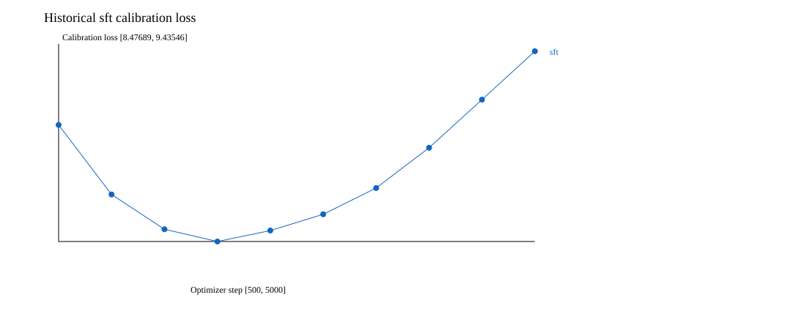
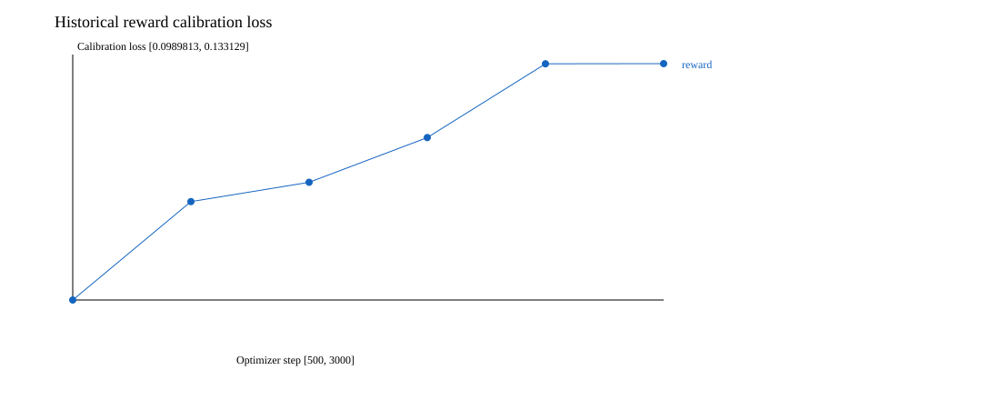
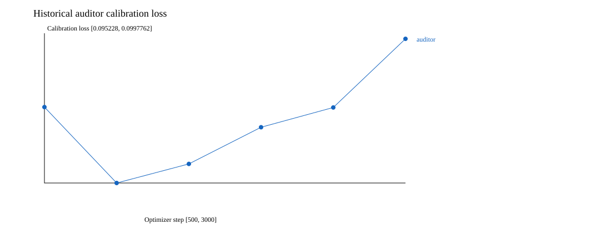
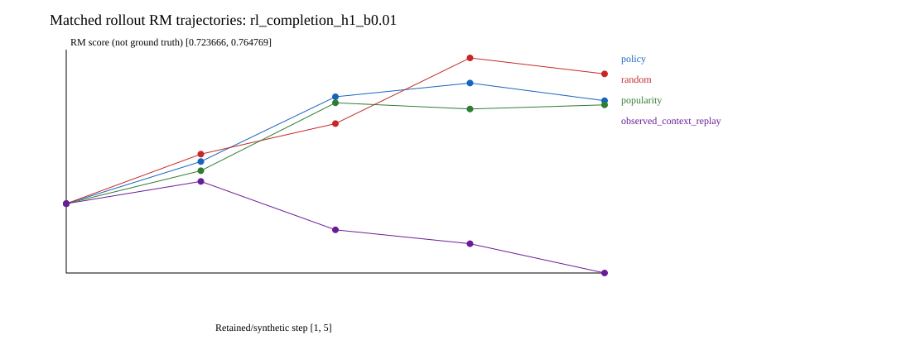

# Exploratory frozen-checkpoint reanalysis

This is not a fresh confirmatory test, a causal estimate, or a new training result.

## Historical supervised checkpoint selection

| Model | Selected step | Calibration loss | Best at first evaluation |
|---|---:|---:|---|
| sft | 2000 | 8.476887 | False |
| reward | 500 | 0.098981 | True |
| auditor | 1000 | 0.095228 | False |

## Inference

| Policy | Eligible expected RM | Eligible NDCG | Recall (all) | Coverage |
|---|---:|---:|---:|---:|
| sft | 0.729139 | 0.044494 | 0.036971 | 0.2954 |
| popularity | 0.729154 | 0.006310 | 0.008294 | 0.0005 |
| rerank_historical | 0.729961 | 0.045192 | 0.036971 | 0.2951 |
| rerank_tuned | 0.729961 | 0.045192 | 0.036971 | 0.2951 |
| rl_completion_h1_b0.01 | 0.729696 | 0.044024 | 0.035750 | 0.2876 |
| rl_completion_h1_b0.1 | 0.729503 | 0.045577 | 0.036639 | 0.2924 |
| rl_completion_h1_b1 | 0.729315 | 0.045302 | 0.036799 | 0.2948 |
| rl_completion_h5_b0.01 | 0.729591 | 0.041887 | 0.034530 | 0.2949 |
| rl_completion_h5_b0.1 | 0.729491 | 0.045241 | 0.035438 | 0.2954 |
| rl_completion_h5_b1 | 0.729299 | 0.045227 | 0.036862 | 0.2959 |

Rerank weight is selected before test inference, on selection only. History sensitivity and append controls do not identify causal user responses.
See results.json for paired intervals, control trajectories, timings and provenance; per_example.npz and evaluation-inputs.npz support independent reconstruction.
Observed-context replay uses retained, potentially gapped contexts, not a consecutive user-transition simulator.

